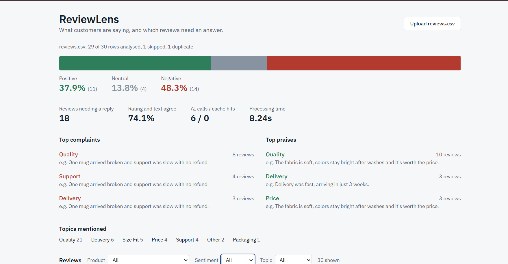
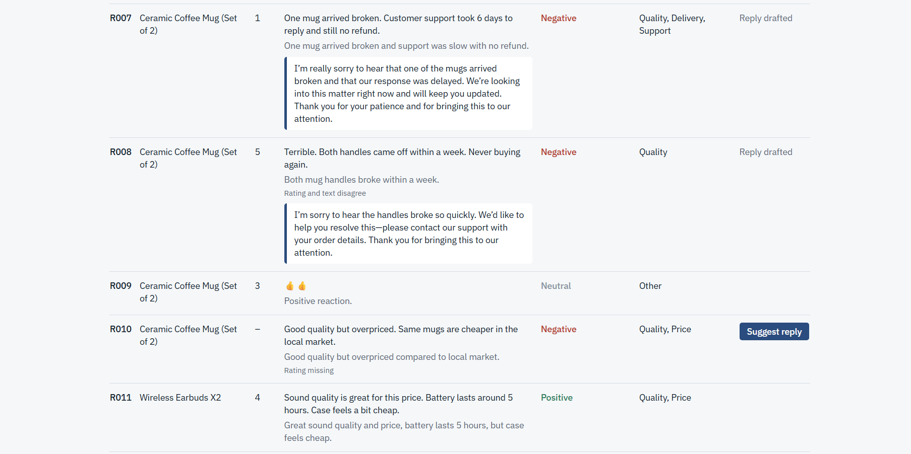
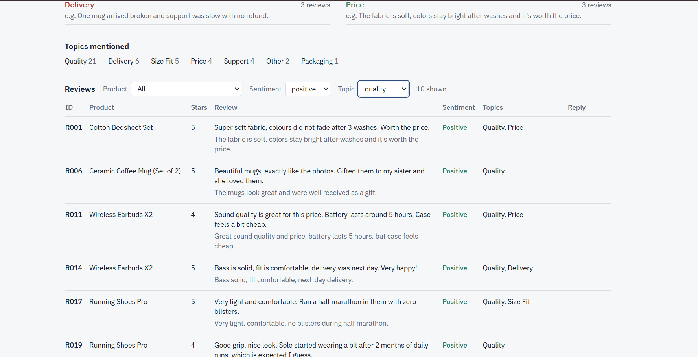

# ReviewLens - AI review insights

ReviewLens turns a CSV of product reviews into sentiment and topic insights, highlights reviews that need a response, and drafts replies when requested.

**Stack:** React + Tailwind (Vite), FastAPI, SQLite, Groq API, pytest

## Setup (Windows PowerShell)

Requirements: Python 3.11+, Node.js 18+, and a Groq API key.

```powershell
# 1. Backend
Set-Location backend
py -3.11 -m venv venv
.\venv\Scripts\Activate.ps1
python -m pip install -r requirements.txt
if (Test-Path .env) {
  Write-Host ".env already exists; leaving it unchanged."
} else {
  Copy-Item .env.example .env
}
# Edit .env and set GROQ_API_KEY. GROQ_MODEL is openai/gpt-oss-20b.
uvicorn app.main:app --reload --port 8000
```

In a second PowerShell terminal:

```powershell
Set-Location frontend
npm install
npm run dev
```

Open http://localhost:5173 and upload `sample_data/reviews.csv`.

Run the backend tests from the backend directory. They use a fake LLM and do not require a Groq key or network access:

```powershell
python -m pytest -q
```

## CSV cleaning and preprocessing

`backend/app/cleaning.py` parses the CSV before AI analysis:

- Byte uploads are decoded as UTF-8 with optional BOM support. Invalid UTF-8 and files without a recognizable review-text column are rejected as file-level errors.
- Header matching strips surrounding whitespace, lowercases names, and accepts aliases for review ID (`review_id`, `id`, `reviewid`), product (`product`, `product_name`, `product_id`, `item`), rating (`rating`, `stars`, `score`), and review text (`review_text`, `review`, `text`, `comment`, `body`, `content`).
- Mapped field values are stripped of leading and trailing whitespace. Missing IDs receive a generated row ID; missing products are stored as `Unknown`.
- Ratings are accepted only as whole-number values from 1 through 5. A missing rating is set to unknown (`None`) and flagged `missing_rating`; a non-numeric, fractional, non-finite, or out-of-range rating is set to unknown and flagged `invalid_rating`. A bad rating does not discard a row with review text.
- Blank or whitespace-only review text is flagged `empty_text` and skipped by the analysis pipeline.
- Duplicate text is detected by hashing a comparison form that lowercases the text and collapses whitespace. The review text itself is not lowercased or whitespace-collapsed in storage. Duplicate rows remain visible, are flagged `duplicate`, and reuse the first matching analysis instead of making another AI call.
- Repeated review IDs are retained and flagged `duplicate_review_id`.
- The original review wording, punctuation, emojis, and Unicode language are preserved apart from surrounding whitespace. Hindi and Hinglish are not translated or rewritten during cleaning. The `date` column in the sample CSV is currently ignored and is not stored.
- Before analysis, review text is limited to 1,000 characters in the LLM request. The stored review text is not clipped to that limit.

Cleaning and AI analysis are separate steps. Cleaning handles CSV structure, whitespace, ratings, empty rows, and duplicates. The AI later assigns sentiment/topics and produces a summary. For example, R016 remains Hindi in the stored review; the model is asked to produce an English summary. That model instruction is not a translation performed by the cleaner.

## Architecture

```text
Browser (React) -- /api --> FastAPI --> cleaning.py   CSV parsing, ratings, text hash, duplicate flags
                                    --> analysis.py   cache lookup, batches, validation retry
                                    --> llm.py        Groq request and exponential backoff
                                    --> validation.py strict analysis-output validation
                                    --> db.py         SQLite reviews, uploads, versioned analysis cache
                                    --> dashboard.py  sentiment, topics, complaints/praises
```

`analysis.py` sends unique uncached texts in sequential batches of five. Invalid analysis output is retried once, and remaining failures are marked `analysis_failed`. Transient Groq rate-limit, server, and network failures use exponential backoff.

The SQLite cache identity is the normalized review-text hash, model name, and analysis prompt/schema version. Re-uploading under the same model and prompt version reuses prior analyses; switching model or prompt version creates a separate cache entry.

The dashboard's top complaints and praises are the most frequent topics among negative and positive analyses, with an example summary. They are topic counts rather than free-text complaint clusters. Duplicate review rows remain visible and count as separate rows in dashboard totals while sharing one analysis.

## Prompt-injection handling

The system prompt in `backend/app/prompts.py` treats review text as untrusted data. Reviews are JSON-encoded in the user message, use positional IDs, and are never inserted into the system prompt. The prompt directs the model to classify the customer's actual experience when text includes an instruction attempt, as in R012. Output is validated against allowed sentiment, topics, summary, and `needs_reply` types. Invalid output is retried once and then marked `analysis_failed`.

These controls reduce prompt-injection risk but cannot guarantee that a model will never produce a valid-schema misclassification.

## API key and configuration

Set `GROQ_API_KEY` in `backend/.env`. The file is git-ignored; `.env.example` contains a placeholder. Only the FastAPI backend calls Groq, and the browser calls the app's `/api` routes. The configured model is `openai/gpt-oss-20b`; override it with `GROQ_MODEL` if needed for your Groq account.

## Verified live run

The 30-row `sample_data/reviews.csv` was processed through the live Groq analysis pipeline using the configured model:

- 30 uploaded rows
- 29 analysed
- 1 skipped (empty review)
- 0 failed
- 6 AI calls and 0 cache hits on that first run

## Known limitations

- Uploads are processed synchronously; large files would benefit from background processing and progress updates.
- Failed analyses are not cached and are retried on re-upload.
- Top complaints and praises are topic-level summaries, not free-text issue clusters.
- The app is single-user and has no authentication.
- The date column is not currently retained.
- There is no per-product page, Docker Compose setup, or public deployment.

## AI coding tools used

- **Claude:** helped scaffold the initial backend, tests, and frontend from the assessment brief.
- **Codex:** assisted with code audits, targeted implementation changes, and documentation updates.
- **ChatGPT:** used for planning, review, and technical discussion during development.

## Screenshots

### Dashboard overview



### Review table and reply drafts



### Positive quality reviews


